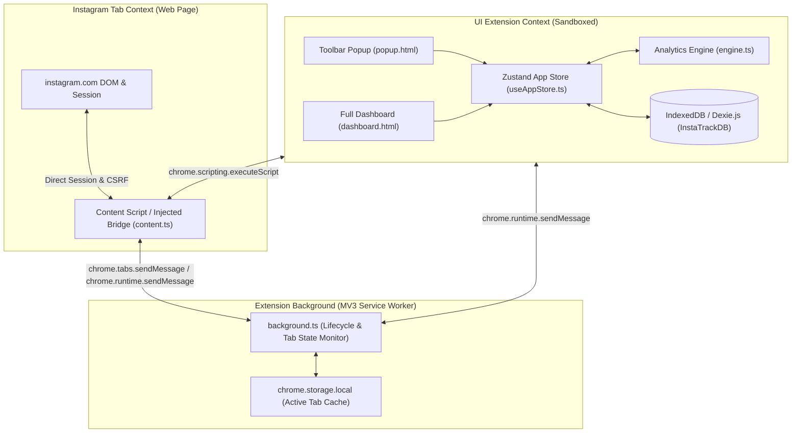
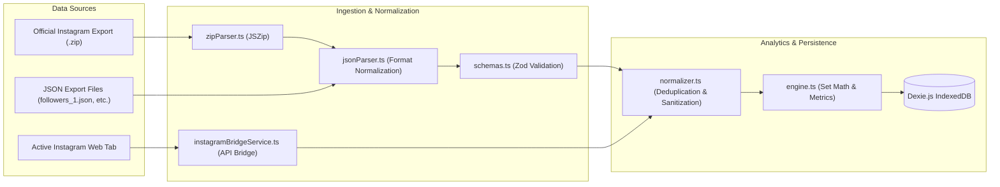

# InstaFlow (InstaTrack) — Architectural Specification

**Document Version**: 2.0  
**Target Environment**: Chrome Manifest V3, Firefox MV3  
**Framework**: WXT, React 18, TypeScript, Dexie.js 4, Zustand 5  

---

## 1. High-Level Architecture

InstaFlow follows a modern, offline-first Chrome Manifest V3 architecture. The extension is partitioned into four primary runtime contexts that communicate through typed message passing and local storage synchronization:



---

## 2. Extension Runtime Contexts

### 2.1 Manifest V3 Background Service Worker (`src/entrypoints/background.ts`)
- **Role**: Lightweight event listener responsible for monitoring browser tab lifecycle events (`chrome.tabs.onUpdated`, `chrome.tabs.onRemoved`, `chrome.tabs.onActivated`).
- **Tab State Tracking**: Employs `instagramTabService` to scan for open Instagram tabs without persisting DOM elements or violating service worker idle timeouts.
- **Message Router**: Handles extension icon clicks (`chrome.action.onClicked`) and routes diagnostic requests between the popup/dashboard and active tabs.

### 2.2 Extension Toolbar Popup (`src/entrypoints/popup/`)
- **Role**: Instant status view accessible from the Chrome toolbar icon.
- **Features**: Displays active Instagram connection state, quick metric badges (followers, following, non-followers), one-click shortcut to launch the full Dashboard, and quick live scan trigger.

### 2.3 Full-Screen Analytics Dashboard (`src/entrypoints/dashboard/`)
- **Role**: Primary user interface for relationship analysis, historical tracking, data filtering, and export.
- **Layout**: Clean Apple Human Interface Guidelines layout with sidebar navigation, warm oat / dark espresso palette, responsive squircle containers, and instant page transitions.

### 2.4 Content Script & In-Tab Bridge (`src/entrypoints/content.ts` & `src/services/live/`)
- **Role**: Operates directly inside active `instagram.com` tabs.
- **Capabilities**:
  - Resolves session credentials via `document.cookie` with automatic fallback to `/data/shared_data/`.
  - Executes authenticated friendship endpoint pagination with adaptive pacing and rate-limit backoff.
  - Performs 1-click unfollow operations via `/api/v1/friendships/destroy/`.

---

## 3. Data Pipelines & Processing Workflows

### 3.1 Dual-Source Ingestion Pipeline



### 3.2 Analytics Mathematical Formulations

Given the normalized sets:
- $\mathcal{F}_{ers}$: Set of accounts that follow the user.
- $\mathcal{F}_{ing}$: Set of accounts the user follows.

The core relationship categories are calculated deterministically:
1. **Not Following Back** (Non-reciprocal Following):
   $$\mathcal{S}_{\text{not\_following\_back}} = \{ u \in \mathcal{F}_{ing} \mid u \notin \mathcal{F}_{ers} \}$$
2. **Fans** (Non-reciprocal Followers):
   $$\mathcal{S}_{\text{fans}} = \{ u \in \mathcal{F}_{ers} \mid u \notin \mathcal{F}_{ing} \}$$
3. **Mutual Followers** (Reciprocal):
   $$\mathcal{S}_{\text{mutual}} = \mathcal{F}_{ers} \cap \mathcal{F}_{ing}$$
4. **Follow-Back Ratio**:
   $$\text{Ratio} = \begin{cases} 0\% & \text{if } |\mathcal{F}_{ing}| = 0 \\ \left( \frac{|\mathcal{S}_{\text{mutual}}|}{|\mathcal{F}_{ing}|} \right) \times 100 & \text{if } |\mathcal{F}_{ing}| > 0 \end{cases}$$

### 3.3 Historical Snapshots & Trend Analysis

Given an earlier baseline snapshot $S_{\text{base}}$ and a later snapshot $S_{\text{current}}$:
1. **Unfollowers** (Lost Followers):
   $$\mathcal{S}_{\text{unfollowers}} = \mathcal{F}_{ers}(S_{\text{base}}) \setminus \mathcal{F}_{ers}(S_{\text{current}})$$
2. **New Followers** (Gained Followers):
   $$\mathcal{S}_{\text{new\_followers}} = \mathcal{F}_{ers}(S_{\text{current}}) \setminus \mathcal{F}_{ers}(S_{\text{base}})$$
3. **Net Follower Growth**:
   $$\Delta_{\text{followers}} = |\mathcal{F}_{ers}(S_{\text{current}})| - |\mathcal{F}_{ers}(S_{\text{base}})|$$

---

## 4. Database Architecture (Dexie.js IndexedDB)

Database Name: `InstaTrackDB`  
Current Schema Version: `2`

### 4.1 Schema Definitions

```typescript
db.version(2).stores({
  snapshots: 'id, timestamp, accountUsername, sourceType',
  snapshot_relationships: '++id, snapshotId, username, relationshipType, [snapshotId+username]',
  accounts: 'username, isWhitelisted, lastSeen',
  import_history: '++id, timestamp, fileName, success',
  settings: 'key',
});
```

### 4.2 Indexing & Performance Strategy
- **Compound Index `[snapshotId+username]`**: Enables $O(1)$ lookups and updates when unfollowing accounts or toggling relationships without full-table table scans.
- **Relational Integrity**: Deleting a snapshot initiates a transactional compound sweep that clears both the snapshot header and all child relationship rows atomically.

---

## 5. Security & Defensive Design

1. **CWE-1236 Immunity**:
   - Every exported cell in CSV and Excel downloads is screened for formula initiation tokens (`=`, `+`, `-`, `@`, `\t`, `\r`).
   - If present, strings are neutralized with a leading single quote (`'`), preventing DDE exploitation in spreadsheet programs.
2. **Client-Side Data Privacy**:
   - 100% of relationship calculations, file decompressions, and snapshot comparisons occur strictly within the client browser.
   - Zero telemetry, zero analytics tracking, and zero remote API endpoints are bundled or contacted.
3. **Instagram Native Session Access**:
   - Avoids asking for or storing user passwords.
   - Operates through authorized browser cookie and `/data/shared_data/` sessions within user-granted tab permissions.
   - Enforces adaptive pacing and rate-limit backoff ($850\text{ms} - 2000\text{ms}$ delays) to ensure session safety.
