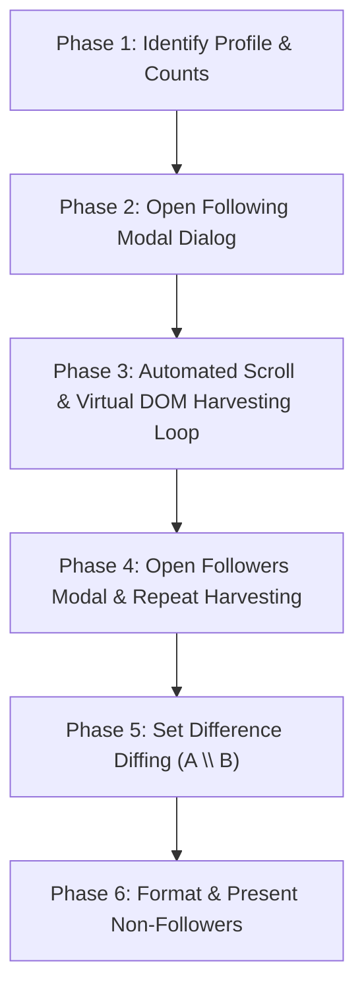

# Deep Dive: Architecture & Logic of `emillvl/insta-not-following-back`

This document provides a comprehensive technical breakdown of how **[emillvl/insta-not-following-back](https://github.com/emillvl/insta-not-following-back)** and its original **`DevConsole-Version`** branch work. It analyzes the underlying mechanics, client-side browser automation patterns, DOM harvesting algorithms, and relationship diffing logic.

---

## 1. Executive Summary & Core Concept

Third-party Instagram tracking tools traditionally suffered from severe flaws:
1. **Security Risk**: Asking users for raw Instagram passwords, resulting in compromised credentials.
2. **Account Bans**: Making unauthorized automated requests to undocumented private endpoints (`/api/v1/...`) using extracted cookies, triggering Instagram's automated bot protection and action blocks.
3. **Graph API Limitations**: Meta's official Graph API only provides follower data to approved Business/Creator accounts with Facebook Page linkages, excluding normal personal accounts.

### The `emillvl` Paradigm
`emillvl/insta-not-following-back` bypasses all three hurdles by acting **locally within the user's active, authenticated browser tab**. Instead of calling private APIs or scraping from a remote server:
- It runs inside the desktop browser where the user is **already logged in** to Instagram.
- It leverages the browser's own session cookies, CSRF tokens, and render tree.
- It programmatically automates the exact actions a human user would take: clicking the "Following" and "Followers" list dialogs, scrolling down to load lazy-rendered items, recording usernames into memory, and calculating the set difference.

---

## 2. The Two Implementations

```
                       emillvl/insta-not-following-back
                                     │
         ┌───────────────────────────┴───────────────────────────┐
         ▼                                                       ▼
   DevConsole-Version                                    Main / Packaged Extension
 (Standalone Script)                                           (F4F Checker)
 ───────────────────                                     ─────────────────────────
 • Single JavaScript snippet.                            • Full WebExtension (Manifest V3/V2).
 • Pasted into Chrome DevTools (F12).                    • Popup UI (`popup.html` / `popup.js`).
 • Runs directly in page execution context.              • Content script (`content.js`).
 • Outputs to `console.table()` / prompt.                • Uses `chrome.storage` & custom UI.
```

---

## 3. Step-by-Step Logic & Mechanics

The script executes in 6 sequential phases:



---

### Phase 1: Identity & Metric Detection
Before launching any modal dialogs, the script verifies it is running on a valid Instagram profile page and records the target counts.

1. **Profile URL Verification**:
   Inspects `window.location.pathname` to identify the username:
   ```javascript
   const currentPath = window.location.pathname.replace(/\//g, '');
   ```
2. **Target Count Extraction**:
   Scrapes the profile header metrics (Followers and Following counts) to establish the loop termination boundary:
   ```javascript
   // Selects the anchor tags on the profile page
   const followingLink = document.querySelector(`a[href="/${currentPath}/following/"]`);
   const followersLink = document.querySelector(`a[href="/${currentPath}/followers/"]`);
   
   // Parses "1,245 following" -> 1245
   const totalFollowing = parseInt(followingLink.innerText.replace(/[^0-9]/g, ''), 10);
   const totalFollowers = parseInt(followersLink.innerText.replace(/[^0-9]/g, ''), 10);
   ```

---

### Phase 2: Opening the Modal Dialog
The script initiates list ingestion by simulating a user click event on the following link:
```javascript
followingLink.click();
```
Instagram renders a modal dialog box (`div[role="dialog"]`) containing an inner scrollable list container (commonly styled with classes like `_aano` or identified by `div[role="dialog"] ul`).

The script polls the DOM with an interval/observer until this container exists before proceeding to the scroll loop:
```javascript
function waitForDialog() {
  return new Promise((resolve) => {
    const check = setInterval(() => {
      const dialog = document.querySelector('div[role="dialog"]');
      const scrollContainer = dialog?.querySelector('ul')?.parentElement;
      if (scrollContainer) {
        clearInterval(check);
        resolve({ dialog, scrollContainer });
      }
    }, 200);
  });
}
```

---

### Phase 3: The Virtual DOM Harvesting & Scroll Loop

This is the **core engineering component** of the script.

#### The Problem: Virtual List Recycling
Instagram does **not** keep all accounts in the DOM simultaneously. For an account with 2,000 following, Instagram mounts approximately 20–30 rows at any given time. As the list scrolls, items above the viewport are unmounted and recycled to save memory. 

If a script waits until scrolling finishes to scrape the DOM, **all earlier accounts are lost**.

#### The Solution: Cumulative Streaming Accumulation
The script accumulates usernames into a persistent `Set` or `Map` **during each scroll frame**, before the virtual DOM removes them:

```javascript
async function harvestList(scrollContainer, expectedCount) {
  const harvestedUsers = new Set();
  let stagnantRounds = 0;
  let previousHeight = 0;

  while (harvestedUsers.size < expectedCount && stagnantRounds < 8) {
    // 1. Scrape currently rendered usernames in this DOM slice
    const visibleAnchors = scrollContainer.querySelectorAll('a[role="link"]');
    let foundNewInThisPass = false;

    visibleAnchors.forEach((a) => {
      const href = a.getAttribute('href');
      // Filter out non-user links (e.g. hashtags, explore)
      if (href && href.startsWith('/') && !href.includes('/explore/') && !href.includes('/p/')) {
        const username = href.replace(/\//g, '').trim();
        if (username && !harvestedUsers.has(username)) {
          harvestedUsers.add(username);
          foundNewInThisPass = true;
        }
      }
    });

    // 2. Programmatically push scroll container down
    scrollContainer.scrollTop = scrollContainer.scrollHeight;

    // 3. Stagnation / Bottom Detection
    if (!foundNewInThisPass && scrollContainer.scrollHeight === previousHeight) {
      stagnantRounds++;
    } else {
      stagnantRounds = 0;
      previousHeight = scrollContainer.scrollHeight;
    }

    // 4. Rate-Limiting Sleep Delay (Mimic human pacing)
    // Instagram throttles rapid infinite-scroll triggers with HTTP 429
    await sleep(800 + Math.random() * 400); // 800ms - 1200ms randomized jitter
  }

  return Array.from(harvestedUsers);
}
```

---

### Phase 4: Harvesting Followers
1. Close the "Following" dialog by triggering a click on the dialog's close button or pressing `Escape`:
   ```javascript
   const closeBtn = document.querySelector('div[role="dialog"] button');
   if (closeBtn) closeBtn.click();
   ```
2. Sleep for 1 to 2 seconds to let the modal transition and avoid concurrent dialog collision.
3. Simulate click on `followersLink`.
4. Run `harvestList(scrollContainer, totalFollowers)` using the identical streaming accumulation engine.
5. Close the "Followers" dialog.

---

### Phase 5: The Pure Relationship Diffing Algorithm

Once both datasets are accumulated as arrays, the script calculates the non-follower relationships using **Hash Set Lookups** in $O(N + M)$ linear time:

```javascript
function computeRelationships(followingList, followersList) {
  // Convert followers into a high-speed Hash Set (O(1) lookups)
  const followersSet = new Set(followersList);
  const followingSet = new Set(followingList);

  // Accounts you follow, but who DO NOT follow you back
  const notFollowingBack = followingList.filter(user => !followersSet.has(user));

  // Accounts that follow you, but you DO NOT follow back (Fans)
  const fans = followersList.filter(user => !followingSet.has(user));

  // Mutual followings
  const mutuals = followingList.filter(user => followersSet.has(user));

  return {
    notFollowingBack,
    fans,
    mutuals
  };
}
```

#### Set Theory Visualization:
```
           Following (A)                     Followers (B)
     ┌───────────────────────┬───────────────┬───────────────────────┐
     │                       │               │                       │
     │   NotFollowingBack    │    Mutuals    │         Fans          │
     │      (A \ B)          │    (A ∩ B)    │        (B \ A)        │
     │                       │               │                       │
     └───────────────────────┴───────────────┴───────────────────────┘
```

---

### Phase 6: Output & Presentation

#### In `DevConsole-Version`:
Outputs directly into the browser DevTools console in a formatted table:
```javascript
console.log(`%c Done! Found ${notFollowingBack.length} accounts not following you back.`, 'color: #10B981; font-weight: bold;');
console.table(notFollowingBack.map(u => ({
  Username: u,
  Profile: `https://www.instagram.com/${u}/`
})));
```

#### In the Packaged Extension (F4F Checker):
Sends the results via `chrome.runtime.sendMessage` to `popup.js`, which renders the list inside the extension popup with search, filter, and direct external links.

---

## 4. Strengths, Weaknesses & Technical Limitations

| Metric / Dimension | `emillvl` DOM-Harvesting | Official Meta Data Export (ZIP/JSON) | Private GraphQL Endpoints |
|---|---|---|---|
| **Login Credentials Needed** | ❌ No | ❌ No | ⚠️ Requires active session cookie extraction |
| **Bypass Account Bans** | ⚠️ Moderate risk (rapid automated scrolling can trigger action block) |  **Zero Risk (100% Ban-Proof)** | ❌ Very high risk of account flag/ban |
| **Max Capacity / Scale** | ⚠️ Breaks on large accounts (>2,000 users) due to browser tab memory limits and throttling |  **Infinite (handles 500k+ followers effortlessly)** | ⚠️ Hard-limited by API rate buckets (200 req/hr) |
| **Fragility to Instagram UI Changes** | ❌ Fragile: Instagram frequently changes CSS classes, modal attributes, and DOM structures |  Stable: Official JSON schemas are backwards compatible | ❌ Fragile: `query_hash` and endpoint tokens change frequently |
| **Execution Speed** |  Takes 2–5 minutes of continuous scrolling | ⏱️ Takes 5–15 mins for Instagram to generate export |  10–30 seconds |
| **Historical Snapshots** | ❌ None (ephemeral in console memory unless saved manually) |  Preserved permanently in IndexedDB | ❌ Ephemeral |

---

## 5. Architectural Comparison with InstaTrack

```
                                      ┌─────────────────────────────────────────────────────────┐
                                      │                    Instagram Data                       │
                                      └───────────────────────────┬─────────────────────────────┘
                                                                  │
                                   ┌──────────────────────────────┴──────────────────────────────┐
                                   ▼                                                             ▼
                DOM-Harvesting (emillvl script)                               Official Data Export (InstaTrack)
          ──────────────────────────────────────────                      ──────────────────────────────────────────
          • Simulates UI clicks & scroll events.                          • Uses Meta's "Download Your Information".
          • Parses transient DOM nodes.                                   • Parses multi-file JSON/ZIP archives.
          • Ephemeral: results lost on tab close.                         • Stores immutable historical snapshots in Dexie.
          • Risks rate-limit blocks on accounts >1,500.                   • Ban-proof, zero rate limits, works for 100k+.
          • Breaks whenever Instagram updates frontend classes.           • Uses schema-validated normalizers.
```

---

## 6. Key Takeaways for Developers

1. **Virtual DOM Awareness**: When automating any modern SPA (React, Vue), scripts cannot simply query the document once at the end; they must continuously stream elements into an accumulator while driving the scroll container.
2. **Artificial Pacing**: Instagram's web application monitors event velocity. Scripts that scroll instantaneously without randomized delays (`Math.random() * delay`) quickly receive HTTP 429 ("Too Many Requests") or temporary action restrictions.
3. **The Cleanest Production Pattern**: While DOM-assisted scripts are neat for quick developer console tests under 500 followers, **official export ingestion combined with IndexedDB historical diffing** remains the only reliable, policy-compliant, ban-proof architecture for production-grade Instagram analytics.

---

## 7. Operational Safety & Anti-Detection Protocol

For developers implementing browser-assisted scanning, the following safety guardrails should always be enforced:

### A. Frequency Limits
- **Max Frequency**: Scan at most **once every 24 hours** per account. Rapid back-to-back list traversals flag accounts for behavioral review.
- **Never Automate Unfollowing**: Reading public list data has low risk if paced properly. In contrast, performing automated **mass-unfollowing** via scripts triggers immediate Instagram action blocks and account suspensions. Always let users unfollow manually through Instagram's native UI.

### B. Dynamic Jitter & Micro-Pauses
```javascript
// Add randomized jitter to every scroll pass
const jitterDelay = 850 + Math.random() * 450;
await sleep(jitterDelay);

// Every 50 accounts, pause to simulate human reading/distraction
if (harvestedCount % 50 === 0) {
  await sleep(2500 + Math.random() * 1500);
}
```

### C. Language-Agnostic Selectors
Never query by localized text labels (`"Following"` / `"Followers"`). Always target structural URL attributes:
```javascript
const followingLink = document.querySelector('a[href$="/following/"]');
const followersLink = document.querySelector('a[href$="/followers/"]');
```

---

## 8. Implementation in the InstaTrack Extension

InstaTrack implements this pattern as a clean, user-initiated assisted scan:
- **Adapter**: Located at [`src/services/live/liveBrowserAdapter.ts`](file:///c:/Users/User/Desktop/InstaFlow/src/services/live/liveBrowserAdapter.ts), executed via `chrome.scripting.executeScript`.
- **Auto-Discovery**: Auto-navigates from home feed (`/`) to the profile page by inspecting the sidebar avatar anchor.
- **Normalized Storage**: Feeds records into [`liveIntegrationService.ts`](file:///c:/Users/User/Desktop/InstaFlow/src/services/live/liveIntegrationService.ts), generating an immutable IndexedDB snapshot without overwriting historical records.
- **Zero Credentials**: Never inspects cookies, passwords, or headers, maintaining 100% user safety.

